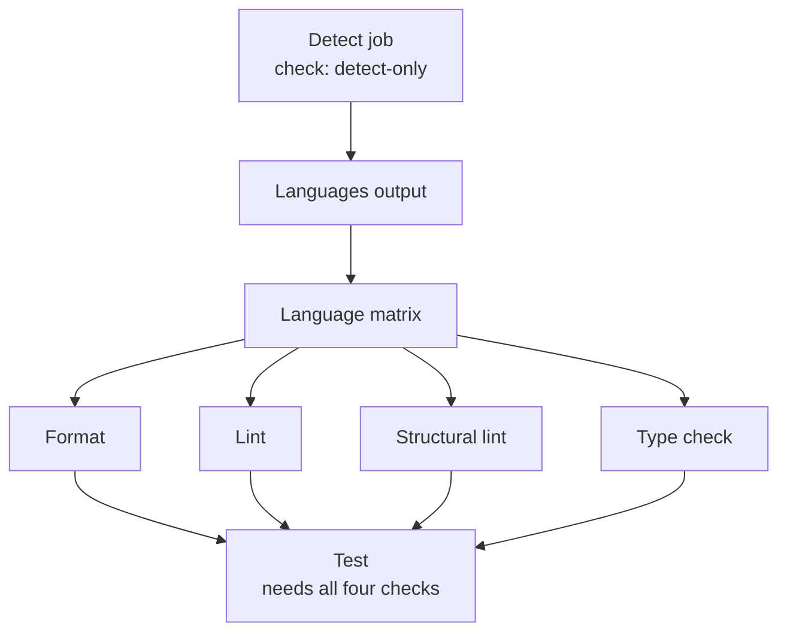

# Quality Gate

Quality Gate is a provider-neutral quality-check engine with a GitHub Actions
adapter. It detects Go, Python, and TypeScript projects and runs formatting,
linting, structural linting, type checks, and tests. Next.js, Vue, and Nuxt
projects are handled by the TypeScript module.

The portable scripts are the source of quality-check behavior. GitHub Actions
provides only orchestration and runner integration. A future GitLab, Bitbucket,
Azure DevOps, or other git-cloud adapter can invoke the same scripts without
changing the checks.

## Workflow Overview




### Repository layout

```text
quality-gate/
├── action.yml                         # GitHub root adapter and dispatcher
├── scripts/
│   ├── capture-failure.sh             # Sourceable failure trap support
│   ├── collect-error.sh               # Portable error selection/truncation
│   ├── detect-languages.sh            # Project marker detection
│   ├── install-ast-grep.sh            # Shared ast-grep installer
│   ├── render-summary.sh              # Portable summary rendering
│   ├── validate-check.sh              # Check-name validation
│   └── lib/
│       ├── diagnostics.sh             # Error and report primitives
│       └── tools.sh                   # Cache and checksum primitives
├── go/
│   ├── action.yml                     # GitHub Go adapter
│   └── scripts/check.sh               # Go checks
├── python/
│   ├── action.yml                     # GitHub Python adapter
│   └── scripts/check.sh               # Python checks
├── typescript/
│   ├── action.yml                     # GitHub TypeScript adapter
│   └── scripts/
│       ├── check.sh                   # TypeScript checks
│       └── project-info.js            # Package manager/framework metadata
├── ai-review/
│   └── action.yml                     # GitHub AI styleguide review adapter
├── cli/                               # Typed Python package (uv + Typer CLI)
│   ├── pyproject.toml
│   ├── uv.lock
│   ├── src/quality_gate/              # quality-gate CLI and ai-review command
│   └── tests/                         # pytest suite
├── tests/scripts/test-portable.sh     # Provider-neutral contract tests
└── docs/testing.md                    # Test strategy and fixture matrix
```

## Portable Contract

Portable entrypoints do not read `GITHUB_*`, `RUNNER_*`, or equivalent
provider-specific variables. They use explicit arguments and the following
documented environment variables:

| Interface | Purpose |
|---|---|
| `--check` | Selects `app:format`, `app:lint`, `app:strlint`, `app:typecheck`, or `app:test` |
| `--working-directory` | Project directory to inspect and execute in |
| `--action-directory` | Directory containing organization rules and fallback configuration |
| `QUALITY_GATE_ERROR_FILE` | Optional file receiving the selected diagnostic report |
| `QUALITY_GATE_OUTPUT_LOG` | Log file used by the sourceable failure-capture helper |
| `QUALITY_GATE_TOOL_CACHE` | Optional tool cache; defaults to `$HOME/.quality-gate-tools` |

The portable result contract is:

- Exit code `0` means the requested operation passed.
- A non-zero exit code means it failed or received invalid input.
- Portable scripts emit human-readable diagnostics to stderr; the GitHub adapter
  also captures command output for its failure relay.
- Detection and metadata entrypoints write stable `key=value` records to stdout.
- Providers decide how to publish diagnostics, annotations, summaries, reports,
  and artifacts.

Example language detection:

```bash
bash quality-gate/scripts/detect-languages.sh \
  --check detect-only \
  --working-directory ./my-project
```

Example direct Python check:

```bash
bash quality-gate/python/scripts/check.sh \
  --check app:lint \
  --working-directory ./my-project \
  --action-directory ./quality-gate/python
```

The caller must provide runtime dependencies such as Go, Node.js, uv, npm, or
pnpm. The scripts manage their pinned quality tools and verify downloaded binary
checksums before execution.

## GitHub Adapter

The public entrypoint remains:

```yaml
- uses: prefeitura-rio/actions/quality-gate@quality-gate-v1.0.0
  with:
    check: app:format
```

The adapter performs these provider-specific operations:

- invokes `uses:` actions for runtime setup;
- manages GitHub matrices and conditional dispatch;
- writes `GITHUB_OUTPUT`, `GITHUB_ENV`, and `GITHUB_STEP_SUMMARY`;
- configures the runner error relay and Bash environment;
- maps portable stdout, stderr, and exit codes into GitHub conventions.

The adapter does not own formatter, linter, structural-rule, typecheck, or test
behavior. Those operations live in the portable scripts.

## Inputs And Outputs

### Inputs

| Input | Required | Values |
|---|---:|---|
| `check` | yes | `app:format`, `app:lint`, `app:strlint`, `app:typecheck`, `app:test`, `detect-only` |
| `working-directory` | no | Project directory; defaults to `.` |
| `language` | no | `go`, `python`, or `typescript` |
| `expected-failure` | no | `true` adds a `## Test` section to the summary for expected-failure scenarios |

### Outputs

| Output | Description |
|---|---|
| `error_message` | Complete or truncated human-readable failure diagnostic |
| `languages` | JSON array returned by `detect-only` |
| `summary_name` | Friendly check, language, and framework name |

## Detection And Dispatch

The dispatcher uses these markers:

| Marker | Language |
|---|---|
| `go.mod` | Go |
| `pyproject.toml` or `setup.py` | Python |
| `package.json` and `tsconfig.json` | TypeScript |

With `detect-only`, all detected languages are returned. With a normal check,
zero detected languages fail, one language is selected automatically, and
multiple languages require the `language` input. This allows a reusable workflow
to detect once and run each language in parallel.

## Checks

| Check | Go | Python | TypeScript |
|---|---|---|---|
| `app:format` | gofumpt, goimports | Ruff format | oxfmt |
| `app:lint` | golangci-lint | Ruff check, complexipy | oxlint with detected framework rules, optional react-doctor |
| `app:strlint` | ast-grep organization and repo rules | ast-grep organization and repo rules | ast-grep organization and repo rules with TSX support and Vue script injection |
| `app:typecheck` | `go vet`, `go build` | basedpyright | Project script, `tsc`, `vue-tsc`, or `nuxt typecheck` |
| `app:test` | `go test -race` | pytest with coverage | npm or pnpm test |

Formatting checks never modify project files. Formatting differences include the
affected files and a local remediation command. The complete formatting diff is
written to the job log rather than the summary. Formatter execution failures
include formatter output when available and the remediation command.

Lint failures use the same bounded `Error:` summary template. Tool-provided
remediation hints are rendered under `How to fix it`; generic lint failures do
not include the legacy `Recent output` section.

Python `app:test` includes coverage; see the [Python Coverage Policy](#python-coverage-policy)
for the default threshold and override rules.

## TypeScript Metadata

`typescript/scripts/project-info.js` is provider-neutral and reports:

- package manager and pinned pnpm version when required;
- Next.js, Vue, or Nuxt framework detection;
- React dependency presence;
- presence of a project `typecheck` script;
- `.node-version` is required for typecheck and test checks; `actions/setup-node`
  consumes and validates the file.

For TypeScript typecheck and test checks, the project must also have a lockfile.
Projects using pnpm must declare `packageManager: pnpm@<version>` in
`package.json`.

Next.js detection takes precedence over Nuxt and Vue. Vue fallback scanning is
bounded to five directory levels and ignores `.git`, `.next`, `.nuxt`,
`node_modules`, `dist`, `build`, and `out` directories.

Next.js projects can opt into route-aware typechecking through their existing
project script, for example `next typegen && tsc --noEmit`. The action does not
run `next typegen` automatically; projects without a typecheck script use the
standard local `tsc --noEmit` fallback.

## Tooling And Configuration

Downloaded binary tools are stored under `QUALITY_GATE_TOOL_CACHE`. Downloads
such as gofumpt and ast-grep are verified against hardcoded SHA-256 checksums.
Go tools installed from modules use pinned versions. npm and pnpm quality tools
use pinned versions through `npx` or the project package manager.
Python typechecks use pinned `basedpyright@1.39.10`, synchronize the project with
`uv sync --frozen --all-groups`, and honor project `pyrightconfig.json` or
`[tool.basedpyright]`/`[tool.pyright]` configuration before using the organization
fallback.
Projects with a `pyproject.toml` must commit a matching `uv.lock` for this check.

### Python Coverage Policy

The Python `app:test` check runs pytest with `pytest-cov` and applies an
organization default total coverage threshold of 80%. Projects can explicitly
override that threshold in the configuration consumed by coverage.py.

Configuration discovery follows coverage.py precedence: `COVERAGE_RCFILE`,
`.coveragerc`, `.coveragerc.toml`, `setup.cfg`, `tox.ini`, and then
`pyproject.toml`. TOML files use the `[tool.coverage]` namespace:

```toml
[tool.coverage.report]
fail_under = 70
```

The equivalent INI configurations are:

```ini
# .coveragerc or a file selected with COVERAGE_RCFILE
[report]
fail_under = 70

# setup.cfg or tox.ini
[coverage:report]
fail_under = 70
```

When either local setting is present, the quality gate does not inject its
default and coverage.py enforces the project value, including `fail_under = 0`.
Projects with a `src/` directory are measured with `--cov=src`; other layouts
use pytest-cov's `--cov` mode to measure imported Python modules.

For checks that support configuration, project configuration takes precedence
over the organization fallback. Formatting uses pinned tool defaults. Structural
lint always runs organization rules first, then the selected additive
repository-local rules from `sgconfig.yaml`, `rules/`, or `.quality-gate/`.
Root-level `sgconfig.yaml` or `rules/` takes precedence over `.quality-gate/`.

Organization fallback files are stored beside the language adapters:

- `go/.golangci.yml`;
- `python/ruff.toml` and `python/pyrightconfig.json`;
- `typescript/.oxlintrc.json`;
- language-specific ast-grep rules under each `rules/` directory.

> **Note on binary downloads:** Prebuilt binary downloads for `gofumpt` and `ast-grep`
target Linux x86_64 (`linux_amd64`) environments, matching standard GitHub Actions
and Linux CI runners. The installers currently always populate the quality-gate
tool cache, so pre-installing those tools elsewhere in `PATH` does not bypass a
download on non-x86_64 architectures such as macOS Apple Silicon or ARM64 Linux.

## AI Review

`quality-gate/ai-review` reviews Go, Python, and TypeScript sources against the
repository styleguide with a model behind an OpenAI-compatible chat completions
API (OpenAI, Azure OpenAI, Gemini, Anthropic and most gateways expose one). Code
outside the styleguide is reported by file and line with a suggested fix, as job
annotations, a job summary, and the `error_message` output. The check is opt-in:
nothing calls a model unless a workflow uses this action.

```yaml
- uses: actions/checkout@9c091bb21b7c1c1d1991bb908d89e4e9dddfe3e0 # v7.0.0
  with:
    fetch-depth: 0
- uses: prefeitura-rio/actions/quality-gate/ai-review@quality-gate-latest
  with:
    model: <model name>
    api-key: ${{ secrets.AI_API_KEY }}
```

| Input | Default | Description |
|---|---|---|
| `working-directory` | `.` | Project directory to review |
| `styleguide` | empty | Styleguide file relative to `working-directory`; empty searches the project root, the repository root, `docs/`, and `.github/` for `STYLEGUIDE.md`, `style-guide.md`, `style_guide.md`, or `STYLEGUIDE` (any case) |
| `base-ref` | `github.base_ref` | Review only the files changed since the merge base with this branch (it must be fetched); empty reviews every tracked file up to `max-files` |
| `model` | required | Model name |
| `api-key` | required | Provider API key, from a secret |
| `base-url` | `https://api.openai.com/v1` | Base URL of the OpenAI-compatible API; HTTPS only, except `localhost` |
| `fail-on` | `error` | Lowest finding severity that fails: `error`, `warning`, or `never` |
| `max-files` | `50` | Maximum number of files sent to the model |

Outputs: `error_message` (report when the review fails) and `summary`
(Markdown summary). The model is told to report only what the styleguide covers
and to treat the code as data; its findings are kept only when they point to a
reviewed file and an existing line. In the action the report is printed with
GitHub workflow commands disabled around it (`::stop-commands::`), so model
output cannot inject commands, and the API key is never sent after an HTTP
redirect (redirects are refused). Files under `node_modules`, `vendor`,
`dist`, `build`, `.venv`, and similar folders are not reviewed. The selected
source files and the styleguide are sent to the configured provider.

The action runs the `ai-review` command of the `quality-gate` Python package in
`cli/`, which can also be run directly:

```bash
QUALITY_GATE_AI_API_KEY=... uv run --project quality-gate/cli quality-gate ai-review \
  --working-directory ./my-project --base-ref main --model <model name>
```

Exit codes: `0` passed, `1` findings at or above `--fail-on`, `2` invalid input
(no styleguide, no API key, unknown base reference), `3` provider failure. The
package is statically typed (basedpyright `all`), linted with the organization
Ruff configuration, and tested with pytest:

```bash
cd quality-gate/cli
uv run --frozen ruff format --check . && uv run --frozen ruff check .
uv run --frozen basedpyright && uv run --frozen pytest
```

## Repository-Local Rules

Repositories can add structural rules without changing the action:

1. Add `sgconfig.yaml` at the project root, or under `.quality-gate/` for a
   multi-project repository.
2. Add rule files under `rules/`.
3. Run `app:strlint`.

Repository-local rules are additive and do not replace organization rules.

## Testing

Run the provider-neutral contract tests locally:

```bash
bash quality-gate/tests/scripts/test-portable.sh
```

The GitHub workflow additionally covers:

- all language checks against passing and failing fixtures;
- organization ast-grep rule tests;
- language detection and overrides;
- repository-local and mandatory policy rules;
- Next.js, Vue, and Nuxt behavior;
- corrupted tool downloads and checksum cleanup;
- reusable workflow dispatch;
- GitHub adapter outputs, error relay, and friendly summary names.

See [`docs/testing.md`](docs/testing.md) for the complete test matrix.

## Reusable Workflow

For a project with one or more language markers:

```yaml
jobs:
  quality:
     uses: prefeitura-rio/actions/.github/workflows/quality-gate.yml@quality-gate-v1.0.0
    with:
      project-name: my-project
      working-directory: .
```

The reusable workflow runs detection first, creates a language matrix, executes
format, lint, structural lint, and typecheck in parallel, and runs tests only
after those checks pass.

The [AI review](#ai-review) runs as an extra `AI Review` job only when it is
enabled:

```yaml
jobs:
  quality:
    uses: prefeitura-rio/actions/.github/workflows/quality-gate.yml@quality-gate-latest
    with:
      project-name: my-project
      working-directory: .
      ai-review: true
      ai-model: <model name>
      # ai-base-url: https://api.openai.com/v1
      # styleguide: docs/STYLEGUIDE.md
    secrets:
      AI_API_KEY: ${{ secrets.AI_API_KEY }}
```

## Future Git-Cloud Adapters

A provider adapter should implement only:

- repository checkout;
- runtime installation and caching;
- matrix or job orchestration;
- provider-native result publication.

It should call the existing portable entrypoints and preserve their arguments,
exit codes, stdout records, stderr diagnostics, and working-directory semantics.
This keeps GitHub-to-GitLab migration limited to orchestration rather than
reimplementing quality checks.
